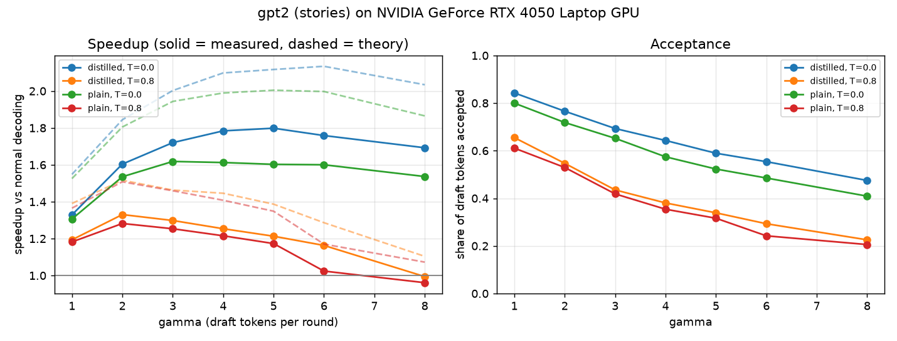

# Speculative Decoding — from scratch

**Make a language model write faster without changing a single word it would write.**

A big language model writes one token at a time, and each token needs a full
pass through the whole model. Most of that time is spent *moving weights*, not
computing. Speculative decoding lets a **small draft model guess** the next few
tokens, and the **big target model checks all the guesses in one pass**. Good
guesses are kept for free. A clever accept/reject rule makes the final text
follow the big model's probabilities **exactly** — not approximately.

This repo builds the whole thing myself, in plain PyTorch:

- my own GPT model with its own KV cache (no HuggingFace model inside),
- the speculative decoding loop: draft → verify → accept/reject → bonus token → cache rollback,
- training a target **and** a draft from scratch on TinyStories, on a 6 GB GPU,
- **distillation** that teaches the draft to think like the target, so more guesses are accepted,
- the same loop on real pretrained pairs (GPT-2 large + DistilGPT-2, Qwen2.5 1.5B + 0.5B),
- tests that prove the output is identical (greedy) or identically distributed (sampling),
- a benchmark that measures the speedup against normal decoding and against the theory.

HuggingFace's built-in `assistant_model` is **not** used anywhere. It is only
used to *load* the pretrained weights.

---

## How it works — one round

```
 text so far ─► DRAFT (small, fast) guesses γ tokens:   the  cat  sat  on
                                                        │    │    │    │
               TARGET (big) checks all γ in ONE pass:   ✓    ✓    ✗ → "lay"
                                                        │    │    │
 kept this round:                                      the  cat  lay        = 3 tokens, 1 big-model pass
```

| Step | What happens |
|------|--------------|
| 1 draft | the small model proposes γ tokens one by one and remembers its probabilities `q` |
| 2 verify | the big model reads all γ at once and gives its own probabilities `p` |
| 3 accept | token `x` is kept with probability `min(1, p(x)/q(x))`, left to right |
| 4 fix | at the first rejection, a replacement is drawn from `max(p − q, 0)` (normalised) |
| 5 bonus | if all γ were accepted, one extra token comes from `p` for free |
| 6 rollback | both KV caches are cut back to the tokens that were kept |

Why the output is still exactly the big model's: see [docs/THEORY.md](docs/THEORY.md).

---

## What is in this folder

| Folder / file | What is inside |
|---------------|----------------|
| `python/` | all the code — **run every command from here** |
| `python/specdec/` | the library: `gpt.py` (model + KV cache), `decoding.py` (normal and speculative decoding), `sampling.py`, `adapters.py`, `training.py`, `benchmarking.py` |
| `python/config.py` | every setting: model sizes, training steps, model pairs, benchmark |
| `python/prepare_data.py` | step 1 — download TinyStories, make token files |
| `python/train_scratch.py` | step 2 — train your target and draft |
| `python/distill_draft.py` | step 3 — make the draft guess like the target |
| `python/benchmark.py` | step 4 — measure the speedup, write tables and plots |
| `START_DEMO.bat` | **double-click: opens the browser demo** (normal vs speculative, side by side) |
| `python/demo_server.py`, `python/demo/` | the demo's local server and page |
| `python/generate.py` | type a few words and watch it complete them, in colour (`--interactive`) |
| `python/smoke_test.py` | 1-minute check that everything works (tiny models, no download) |
| `python/tests/` | correctness tests (`pytest`) |
| `python/*.bat`, `run_overnight.ps1` | Windows launchers |
| `python/data/`, `checkpoints/`, `results/`, `logs/` | made by the scripts (data and checkpoints are not uploaded to GitHub) |
| `docs/THEORY.md` | the maths: exactness proof, speedup formula |

---

## Quick start (Windows)

Once:

```bat
cd python
setup.bat            :: makes .venv, installs PyTorch with GPU support (~10 min)
smoke_test.bat       :: 1-minute check + unit tests
```

Then, every time, open a terminal in `python\` and activate the environment:

```bat
.venv\Scripts\activate

python prepare_data.py                     :: 1. TinyStories -> data\        (10-20 min)
python train_scratch.py --model target     :: 2. your 51M-param target      (1-2 h)
python train_scratch.py --model draft      ::    your 15M-param draft       (20-40 min)
python distill_draft.py --pair scratch     :: 3. draft learns from target   (20-40 min)
python benchmark.py --pair scratch         :: 4. measure the speedup
python generate.py --interactive          :: type a few words, it completes them (in colour)
```

**The demo:** double-click **`START_DEMO.bat`** in the repo folder. It loads the models and opens
a page in your browser where you type a prompt and watch normal and speculative decoding race
side by side, with the draft's accepted tokens in green (GUIDE_4, section 1).

Or everything in one go, overnight (4–6 hours, log in `python\logs\`):

```bat
powershell -ExecutionPolicy Bypass -File .\run_overnight.ps1
```

Times are rough guesses for a 6 GB laptop GPU. Your log prints the real ETA.

---

## The guides — read in this order

1. **[GUIDE_1_SETUP.md](GUIDE_1_SETUP.md)** — install, check the GPU, run the tests
2. **[GUIDE_2_TRAIN_YOUR_OWN.md](GUIDE_2_TRAIN_YOUR_OWN.md)** — data, target, draft, distillation
3. **[GUIDE_3_PRETRAINED_PAIRS.md](GUIDE_3_PRETRAINED_PAIRS.md)** — GPT-2 and Qwen pairs
4. **[GUIDE_4_RESULTS.md](GUIDE_4_RESULTS.md)** — benchmark, read the numbers, put them on GitHub

---

## Results

**GPU:** NVIDIA GeForce RTX 4050 Laptop (6 GB), fp16 — 20 prompts × 128 new tokens.
Speedup = tokens/s with speculative decoding ÷ tokens/s with normal decoding, same
target, same prompts. Full tables: [`python/results/RESULTS.md`](python/results/RESULTS.md).

| Pair | Target / draft | Prompts | Draft | Temp | Best γ | Accepted | Tokens per target pass | Speedup |
|------|----------------|---------|-------|-----:|-------:|---------:|-----------------------:|--------:|
| gpt2 | 774M / 82M | general | plain | 0 | 5 | 56% | 3.74 | 1.72× |
| gpt2 | 774M / 82M | general | **distilled** | 0 | 2 | 77% | 2.53 | **1.91×** |
| gpt2 | 774M / 82M | stories | plain | 0 | 3 | 65% | 2.94 | 1.62× |
| gpt2 | 774M / 82M | stories | **distilled** | 0 | 5 | 59% | 3.90 | **1.80×** |
| gpt2 | 774M / 82M | stories | distilled | 0.8 | 2 | 55% | 2.08 | 1.33× |
| scratch | 51M / 15M | stories | plain | 0 | 2 | 64% | 2.26 | 0.96× |
| scratch | 51M / 15M | stories | distilled | 0 | 3 | 59% | 2.75 | 1.00× |



What the numbers say:

- **Up to 1.91× faster on GPT-2 large**, with the same output. Normal decoding: 19 tokens/s; speculative: up to 36.
- **Distillation works.** Distilling DistilGPT-2 towards GPT-2 large on TinyStories (1,000 steps, 45 min)
  raised the measured acceptance from 58.7% to 73.9%, and the best greedy speedup on story prompts
  from 1.62× to 1.80×. It did not hurt on general prompts — it helped there too (1.72× → 1.91×).
- **Small models don't benefit.** My own 51M target makes 2.75 tokens per pass with the distilled
  draft — the algorithm works — but one pass takes only ~6.6 ms, so per-token Python and GPU-sync
  overhead in the decoding loop cancels the gain (1.00× measured vs 1.47× theory). Speculative
  decoding pays off when the target is expensive per pass.
- **Measured stays below theory** (1.80× vs 2.12× at γ = 5): the formula ignores that verifying
  γ+1 tokens costs a bit more than one, and the loop's own overhead.
- **Temperature 0.8 roughly halves the gain** (≈1.3×): sampled drafts agree with the target less often.
- **Greedy output identical in 18 of 20 prompts on the GPU.** The other 2 are fp16 rounding flipping
  a near-tie (1 token vs γ+1 tokens per pass take different kernels). Re-run in fp32 on CPU, the
  scratch pair matches on **20 of 20**.

**Correctness:** 19 unit tests pass — greedy speculative output is token-for-token
identical to the target alone for γ ∈ {0, 1, 2, 4, 7} even with a *random* draft,
and sampled outputs match the target's exact distribution (total variation < 0.06
over 4,000 samples), including with temperature + top-p.

---

## What is new here, and what to try next

Beyond re-implementing the paper:

- **Distilling for acceptance.** The acceptance rate of speculative decoding is
  exactly `1 − TV(p, q)`. `distill_draft.py --loss tv` trains the draft on that
  quantity directly; `--loss kl` is the usual distillation. Compare them.
- **Domain-adapted drafts.** Distilling DistilGPT-2 towards GPT-2 large on
  stories should raise acceptance on story prompts much more than on general
  prompts. `benchmark.py --prompts stories|general` measures exactly that.
- **Measured vs. theory.** Every run is plotted against the formula
  `S(γ) = (1 − α^{γ+1}) / ((1 − α)(γc + 1))` using the measured α and cost ratio c.
  Where they differ is overhead the formula ignores.

Next directions (each could be a paper-sized experiment):

1. **Adaptive γ** — change the draft length every round from the recent acceptance.
2. **Tree drafts** — verify several candidate branches in one pass (SpecInfer, Medusa).
3. **Self-speculation** — use the target's own early layers as the draft.
4. **Different tokenizers** — a draft and target that do not share a vocabulary.
5. **Batched speculation** — more than one sequence at a time.

---

## Tests

```bat
python -m pytest
```

| Test file | What it proves |
|-----------|----------------|
| `test_gpt.py` | the KV cache gives the same logits as a full pass; crop rolls back exactly |
| `test_sampling.py` | temperature / top-k / top-p; the residual identity that makes the method exact |
| `test_speculative.py` | greedy = target alone (any draft, any γ, context limit, end and stop tokens, HuggingFace models); sampling distribution = target's |

---

## References

- Leviathan, Kalman, Matias. *Fast Inference from Transformers via Speculative Decoding.* ICML 2023.
- Chen, Borgeaud, Irving, Lespiau, Sifre, Jumper. *Accelerating Large Language Model Decoding with Speculative Sampling.* 2023.
- Zhou et al. *DistillSpec: Improving Speculative Decoding via Knowledge Distillation.* ICLR 2024.
- Eldan, Li. *TinyStories: How Small Can Language Models Be and Still Speak Coherent English?* 2023.

---

## License

MIT — see [LICENSE](LICENSE).
