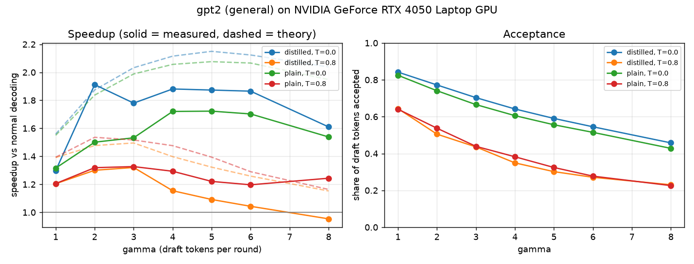
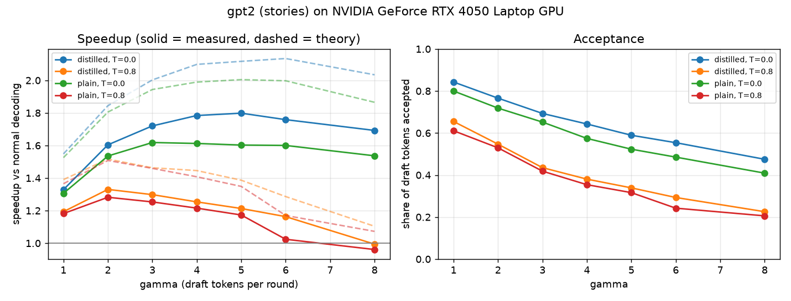
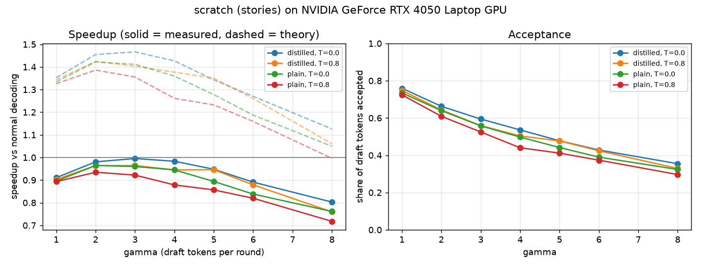

# Results

Written by `benchmark.py`. Newest run per pair and prompt set. Speedup = tokens/s with speculative decoding / tokens/s with normal decoding (same target model, same prompts).

## gpt2 — general prompts (2026-11-17_0228, NVIDIA GeForce RTX 4050 Laptop GPU)

Target 774.0M params. Drafts: plain 81.9M (c = 0.177), distilled 81.9M (c = 0.181). 20 prompts x 128 new tokens.

| Draft | Temp | Best γ | Accepted | Tokens / target call | Tokens/s (normal → spec) | Speedup | Theory | Greedy exact |
|---|---:|---:|---:|---:|---:|---:|---:|---:|
| distilled | 0.0 | 2 | 77% | 2.53 | 19 → 36 | **1.91×** | 1.87× | 90% |
| distilled | 0.8 | 3 | 44% | 2.29 | 20 → 26 | **1.32×** | 1.50× | — |
| plain | 0.0 | 5 | 56% | 3.74 | 19 → 32 | **1.72×** | 2.08× | 90% |
| plain | 0.8 | 3 | 44% | 2.30 | 20 → 26 | **1.33×** | 1.52× | — |

## gpt2 — stories prompts (2026-11-17_0139, NVIDIA GeForce RTX 4050 Laptop GPU)

Target 774.0M params. Drafts: plain 81.9M (c = 0.180), distilled 81.9M (c = 0.190). 20 prompts x 128 new tokens.

| Draft | Temp | Best γ | Accepted | Tokens / target call | Tokens/s (normal → spec) | Speedup | Theory | Greedy exact |
|---|---:|---:|---:|---:|---:|---:|---:|---:|
| distilled | 0.0 | 5 | 59% | 3.90 | 19 → 34 | **1.80×** | 2.12× | 90% |
| distilled | 0.8 | 2 | 55% | 2.08 | 19 → 25 | **1.33×** | 1.52× | — |
| plain | 0.0 | 3 | 65% | 2.94 | 19 → 30 | **1.62×** | 1.94× | 90% |
| plain | 0.8 | 2 | 53% | 2.05 | 19 → 24 | **1.28×** | 1.51× | — |

## scratch — stories prompts (2026-11-16_2157, NVIDIA GeForce RTX 4050 Laptop GPU)

Target 51.0M params. Drafts: plain 14.5M (c = 0.300), distilled 14.5M (c = 0.301). 20 prompts x 128 new tokens.

| Draft | Temp | Best γ | Accepted | Tokens / target call | Tokens/s (normal → spec) | Speedup | Theory | Greedy exact |
|---|---:|---:|---:|---:|---:|---:|---:|---:|
| distilled | 0.0 | 3 | 59% | 2.75 | 150 → 150 | **1.00×** | 1.47× | 90% |
| distilled | 0.8 | 3 | 56% | 2.64 | 151 → 146 | **0.96×** | 1.40× | — |
| plain | 0.0 | 2 | 64% | 2.26 | 150 → 145 | **0.96×** | 1.42× | 90% |
| plain | 0.8 | 2 | 61% | 2.21 | 151 → 141 | **0.93×** | 1.39× | — |

